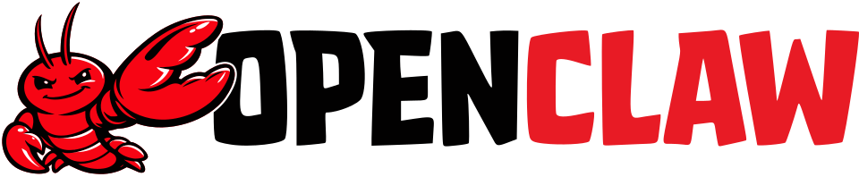

# What is it?

OpenClaw is a free and open-source autonomous AI agent that can execute tasks via large language models, using messaging platforms as its main interface.

# Functionality

Its essentially an AI-based virtual assistant serving as an agentic interface for automated workflows across all the supported services. OpenClaw bots run locally and are designed to integrate with an external LLM model like ChatGPT, Claude and others. Configuration and interaction history are stored locally.

# Skills

OpenClaw uses a skills system that explains how to accomplish certain tasks, in particular how to call tools. Skills are stored in directories containing the SKILL.md file with the metadata and instructions. Skills can be bundled up with the software, installed globally or stored in a workspace.

OpenClaw has seen adoption and can quickly automate many tasks including research, website audting and CRM integration.

# Community and Ecosystem

Openclaw's open source model has fostered a growing ecosystem of third party tools, deployment services and content platforms. Many people online have built deployment guides, skill directories, and use cases collectors around the framework.

