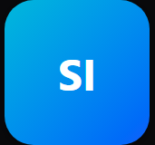

# Agentic AI

A comprehensive list of agentic AI tools which can be used in many different ways. Whether that's in enterprise solutions, production environments and anything in between.

## Corvin OS

Corvin OS is an open-source operating system for teams that need pluggable engines, audited workflows and compliance controls. It combines a browser-based chat, voice and messaging bridges, data connectors and multi-step orchestration in one platform.

## Gobii

Gobii is an AI agent platform for automating web-based work through browser actions, email, SMS and API's. It's built for individuals, teams and developers who need repeatable workflows handled without manual effort.

## Blits.ai

Blits.ai is an enterprise AI platform for deploying autonomous agnets, voice assistants, digital humans and agentic payment workflows. It can connect customer-facing channels with business systems, and can run as a managed service, in your cloud or on premises.

## ToothFairy AI

ToothFairyAI is a cloud AI-agent studio for organizations that need to build and run autonomous agents with privacy and data-residency controls. It offers no-code agent templates for tasks such as research, data analysis, reporting, voice support, and multi-agent project coordination.

## Robutler

Robutler is a web-based platform for running an “agent economy,” where AI agents can find each other, communicate, and complete jobs together in real time. It also appears to support built-in payments and revenue splitting for agent services.

## SimplAI

SimplAI is an enterprise agentic AI operating system for building and running governed AI agents. It combines agent and workflow building with multi-model orchestration, enterprise integrations, observability, and deployment options for cloud, on-premises, and air-gapped environments.

## RentAgents Marketplace

Rent specialist AI agents for recruitment, sales, support, research, marketing, and operations. You connect your own AI provider, set permissions and approvals, and monitor every action from one workspace.

## Amelia 

Amelia is SoundHound AI’s conversational AI platform for enterprises that want to automate customer and employee interactions. It is designed for voice and text conversations that can take action, not just answer questions.

## Notion AI

Notion AI helps teams search, generate, analyze, and chat directly inside Notion. It also includes agents that can complete multi-step work using context from your workspace and connected apps.

## InteractiveAI

InteractiveAI is a cloud platform for building, deploying, and monitoring AI agents with enterprise controls. It includes a free tier, support for 200+ models, and paid plans for production teams.