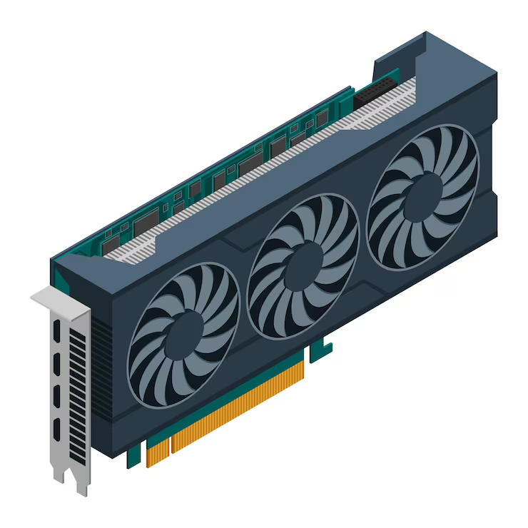

# Graphics Processing Units (GPUs)

## 1. What Is a GPU?
- A **Graphics Processing Unit (GPU)** is a processor designed to handle many calculations simultaneously.
- Originally developed for rendering graphics, 3D environments, and video.
- Today, GPUs are also essential for AI, machine learning, scientific computing, and data processing.
- Unlike CPUs, which focus on a smaller number of complex processing tasks, GPUs contain thousands of smaller processing units designed for parallel workloads.

### Common GPU Applications
- Gaming and 3D rendering.
- Video editing and animation.
- Artificial intelligence and machine learning.
- Cryptocurrency mining.
- Scientific simulations and data processing.

## 2. GPU Architecture

GPU architecture describes how a GPU is internally designed and how its processing resources are organized.

### Important Components
- **CUDA Cores / Shader Cores:** Processing units responsible for performing mathematical operations.
- **Streaming Multiprocessors (SMs):** NVIDIA's groups of processing resources that execute parallel workloads.
- **Compute Units (CUs):** AMD's equivalent organizational building blocks.
- **VRAM:** Dedicated memory used to store textures, graphics data, and other workloads.
- **Memory Bandwidth:** How quickly data can move between GPU memory and processing units.
- **Tensor / Matrix Cores:** Specialized hardware designed to accelerate AI and mathematical operations.
- **Ray Tracing Cores:** Specialized hardware for realistic lighting, reflections, and shadows.

### Memory Technologies
- **GDDR:** High-speed graphics memory commonly used in consumer graphics cards.
- **HBM (High Bandwidth Memory):** Extremely fast, stacked memory commonly used in AI and data center accelerators.
- **VRAM Capacity:** Determines how much graphics or computing data can be stored locally.

## 3. Major GPU Brands and Architectures

### NVIDIA
- Industry leader in high-performance consumer GPUs and AI accelerators.
- Consumer graphics cards belong to the **GeForce RTX** family.
- Data center accelerators belong to the **NVIDIA H-series and B-series** families.

Important architectures:
- **Ampere:** RTX 30-series.
- **Ada Lovelace:** RTX 40-series.
- **Blackwell:** RTX 50-series and data center AI accelerators.
- **Rubin:** Next-generation AI-focused architecture and platform.

Key technologies:
- CUDA: GPU programming and computing platform.
- Tensor Cores: Accelerate AI workloads.
- RT Cores: Hardware-accelerated ray tracing.
- DLSS: Uses AI to improve gaming performance and image quality.

### AMD
- Major competitor to NVIDIA in consumer graphics and data center computing.
- Consumer GPUs belong to the **Radeon RX** family.
- Professional AI accelerators belong to the **Instinct** family.

Important architectures:
- **GCN:** Older graphics and compute architecture.
- **RDNA:** Modern gaming-focused architecture.
- **RDNA 2:** Radeon RX 6000 series.
- **RDNA 3:** Radeon RX 7000 series.
- **RDNA 4:** Radeon RX 9000 series.
- **CDNA:** Dedicated compute architecture for AI and scientific workloads.

Key technologies:
- ROCm: Open software platform for GPU computing and AI.
- Matrix Cores: Accelerate AI and mathematical operations.
- FSR: Image upscaling technology for gaming.

### Intel
- Competes in integrated graphics, discrete GPUs, and data center computing.
- Consumer graphics cards belong to the **Intel Arc** family.

Important architectures:
- **Xe-LP:** Integrated graphics.
- **Xe-HPG:** Gaming-focused graphics.
- **Xe-HPC:** High-performance computing.
- **Xe2:** Second-generation Xe architecture, including Arc Battlemage.
- **Xe3:** Third-generation Xe architecture.

Key technologies:
- XMX (Xe Matrix Extensions): Dedicated hardware for AI calculations.
- XeSS: AI-assisted image upscaling.
- Intel oneAPI: Software development platform for heterogeneous computing.

## 4. How AI Is Being Integrated Into GPUs

AI is increasingly becoming a fundamental part of GPU architecture rather than simply software running on top of it.

### Dedicated AI Hardware
- Modern GPUs include specialized processing units designed for AI calculations.
- NVIDIA uses Tensor Cores.
- AMD uses Matrix Cores.
- Intel uses XMX engines.
- These units accelerate matrix multiplication, a fundamental operation in neural networks.

### AI Applications
- **AI Model Training:** Processing enormous datasets to train machine learning models.
- **AI Inference:** Running already-trained models to generate predictions and responses.
- **Image Generation:** Generating images using models such as diffusion models.
- **Gaming:** AI-powered upscaling, frame generation, and image reconstruction.
- **Video:** AI-assisted editing, enhancement, and noise reduction.
- **Local AI:** Running language models and other AI applications directly on personal computers.

### AI-Specific Technologies
- NVIDIA TensorRT: Optimizes AI model inference.
- NVIDIA CUDA: Provides access to GPU computing capabilities.
- AMD ROCm: Enables AI and high-performance computing on AMD GPUs.
- Intel XMX: Accelerates AI workloads on supported Intel graphics hardware.

## 5. Important Industry Trends

- **AI Accelerators:** GPUs are increasingly designed specifically for training and running large AI models.
- **Chiplet Design:** Modern processors can combine multiple smaller silicon dies into one package.
- **HBM Memory:** High-bandwidth memory is becoming increasingly important for large AI workloads.
- **Power Efficiency:** Manufacturers are trying to deliver more computing performance per watt.
- **AI PCs:** Consumer processors increasingly combine CPUs, GPUs, and dedicated NPUs.
- **Data Center GPUs:** Companies are building entire computing systems around interconnected GPU clusters.

## 6. Quick Comparison

| Manufacturer | Consumer GPU Brand | Major Architecture | AI Technology |
|---|---|---|---|
| NVIDIA | GeForce RTX | Blackwell | Tensor Cores |
| AMD | Radeon RX | RDNA 4 | Matrix Cores |
| Intel | Arc | Xe2 / Xe3 | XMX |

**Important distinction:** GPU brands, architectures, and individual graphics cards are different things. For example, NVIDIA is the manufacturer, Blackwell is an architecture, and the RTX 5080 is a graphics card based on that architecture.