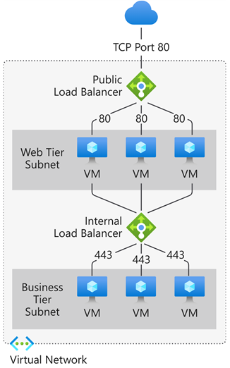
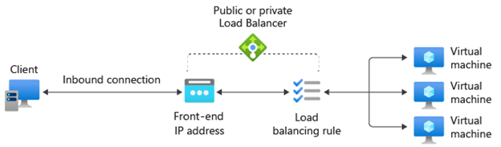
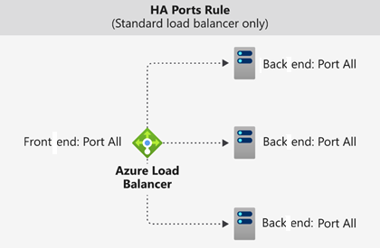

Explains what Azure load balancer does, how it works, and when you should choose to use load balancer as a solution to meet your organization's needs.

# What is a load balancer?

Applications can have so much incoming traffic that the single server hosting them becomes overwhelmed and can't respond to client requests in a timely manner. Instead of adding more resources, you can address this by implementing load balancing.

Load balancing is a process in which you distribute incoming traffic equitably across multiple computers. A pool of computers that have lower levels of resources often responds to traffic more effectively than a single server with higher performance.

Azure load balancer is an Azure Service that allows you to evenly distribute incoming network traffic across a group of Azure VM's, or across instances in a Virtual Machine Scale Set. 

Load-balancing rules then determine how traffic is distributed to instances that compromise the back end.
Also, Health Probes ensure that the resources in the back end are healthy and that traffic isn't directed to unhealthy back-end instances.

In Azure, you can deploy public load balancers or private (internal) load balancers.

Public load balancers are used to load balance internet traffic to your Virtual Machines (VMs). 

An internal load balancer directs traffic to resources that are inside a virtual network or that use a VPN to access Azure Infrastructure.

# How Azure Load Balancer works

Azure Load Balancer operates at the transport layer layer of the OSI model. The load balancer has several elements that work togehter to ensure an applications's high availability and performance:

Front-end IP
Load balancer rules
Back-end pool
Health probes
Inbound NAT rules
High availability ports
Outbound rules

The front-end IP address is the address clients use to connect to your web application. A front-end IP address can be either a public or a private IP address.

A load balancer rule defines how traffic is distributed to the back-end pool. The rule maps a given front-end IP and port combination to a set of back-end IP addresses and port combination.

The back-end pool is a group of VMs or instances in a Virtual Machine Scale Set that responds to the incoming request. To scale cost-effectively to meet high volumes of incoming traffic, computing guidelines generally recommend adding more instances to the back-end pool.

A health probe is used to determine the health status of the instances in the back-end pool. This health probe determines if an instance is healthy and can receive traffic.

You can use load balancing rules in combination with Network Address Translation (NAT) rules. For example, you could use NAT from the load balancer's public address to TCP 3389 on a specific VM. This rule combination allows remote desktop access from outside of Azure.

A load balancer rule configured with protocol - all and port - 0 is known as a high availability (HA) port rule. This rule enables a single rule to load balance all TCP and UDP flows that arrive on all ports of an internal standard load balancer.

An Outbound rule configures Source Network Address Translation (SNAT) for all VMs or instances identified by the back-end pool. This rule enables instances in the back end to communicate (outbound) to the internet or other public endpoints.

# When to use Azure Load Balancer

It is best suited for applications that require ultra-low latency and high performance. You can configure public load balancers for front end traffic web tiers of applications. You can also configure internal load balancers to balance traffic between web tier and the tier that performs data analysis and transformation tasks.

# When not to use Azure Load Balancer

Azure load balancer isn't needed if you have a web application that doesn't require load balancing running on a single laaS VM instance. For example, if a web application only receives a small amount of traffic and the existing infrastructure already deals with the existing load, there's no need to delpoy a back-end pool of VMs and zero need to use a Load Balancer.

