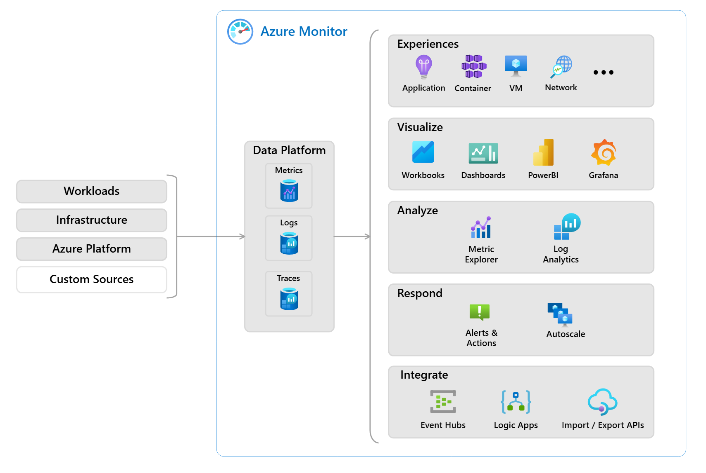
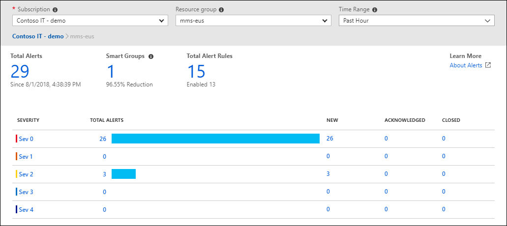

# Azure Advisor

Azure Advisor evaluates your azure resources and makes recommendations to help you improve reliability, security, performance, and cost efficiency. It's like a built-in best-practices guide in Azure Portal.

The advisor dashboard displays recommendations for all your subscriptions, and you can filter by subscription, resource group or service. 

Recommendations fall into five categories:

1. Reliability helps keep your applications running by flagging configuration risks.
2. Security detects threats and vulnerabilities that could lead to breaches.
3. Performance identifies changes that can speed up your applications.
4. Operational Excellence suggests workflow and deployment imporvements.
5. Cost finds ways to reduce your azure spending.

# Azure Service Health

Azure Service Health helps you stay informed about the health of azure itself and the specific resources you run. It combines three views that narrow in scope from global down to individual resources.

There are three health views:

1. Azure Status gives you a global picture of Azure health across all services and regions. Check this page when you hear about a widespread outage and want to know whether it affects Azure.
2. Service Health focuses on the Azure services and regions you actually use. Because you're signed in, Service Health knows which services matter to you and shows outages, planned maintenance, and health advisories relevant to your environment. You can set up alerts so you're notified automatically
3. Resource Health zooms in on individual resources, such as a specific virtual machine. It tells you whether a resource is running normally or experiencing a problem, and whether the issue is on Azure's side or yours.

Used together, these three views give you the visbility from broad service events all the way down to a single resource. Historical alerts are also retained so you can spot recurring trends.

Operational Value:
When an event affects one of your workloads, Azure service health provides links to support so you can respond quickly.

# Azure Monitor

Azure Monitor is a platform for collecting, analyzing, and acting on data from your Azure resources and applications. It works with Azure, on-premises and multicloud environments.

Azure Monitor gathers logs and metrics from your apps, operating systems, and network layers, stores data centrally, and makes it available through dashboards, queues and alerts.

Azure Log Analytics:
A tool that lets you write and run queries against the data Azure Monitor collects. This can help you find errors or visualize trends over time.

Azure Monitor alerts:
Alert you when Azure Monitor has detected that a condition you defined has been met. You can create an alert rule that specifies the condition, and an action group that controls who gets notified and what happens next.

Application Insights:

Lets you monitor the performance and usage of your web applications, whether they run on Azure, on-premises or even in another cloud.

You can set this up by adding an SDK to your application code or by enabling application insights without code changes.

Application Insights can monitor:
1. Request rates, response times, and failure rates
2. Dependency calls and their performance
3. Page load times, user counts, and session trends
4. Server performance counters such as CPU, memory, and network usage
