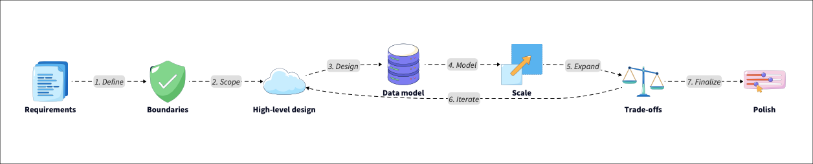

# System Design

## What is System Design?

System Design is the process of defining how indovidual software components come together to meet a set of requirements. It connects abstract business goals and concrete technical implementations. This involves making choices about architecture, data flow, scalability, fault tolerance, and trade offs among goals such as cost speed, and complexity.

System Design generally falls into two categories:

High level system design that focuses on the overall architecture, communication between services, and major technology choices.

Low level system design zooms into how individual modules, API's, or data models work internally.

A good System design balances multiple qualities:

1. Scalability to ensure the system handles growth.

2. Reliability to guarantee it works despite failures.

3. Performance that focuses on meeting latency and throughput goals.

4. Maintainability that ensures the code is easy to debug and evolve.

5. Cost-efficiency that ensures resources are used widely.

These are not independent concerns, and every choice always comes with trade-offs. A skilled system designer can navigate those trade-ffs thoughtfully. 

## Why System Design is important?

System design bridges the gap between theoretical knowledge and real-world software engineering. It is where computer science fundamentals, such as algorithms, data structures, networking and databases all come together to create reliable systems for real-world users.

Mastering system design matters for several reasons:

1. Scalability is no longer optional. Modern applications must serve millions of people globally. System design teaches you how to build to scale from database sharding to load balancing.

2. Reliability is key. A well designed system minimizes downtimes, isolates failures and recovers gracefully. This protects user trust and business continuity.

3. Engineering Maturity. Understanding system design helps you think beyond code, anticipate bottlenecks, and communicate better with architects, DevOps engineers and stakeholders.

4. Career growth. Senior engineers and tech leads are expected to think in systems. This includes designing architectures, evaluating trade-offs, and mentoring others through design decisions.

Ultimately, System Design is about thinking holistically. It involves understanding how to build a feature and how that feature fits into the system that lasts. This skill is the key differentiator for senior engineering roles.

To build these systems effectively, you need shared language of core concepts.

## Key Concepts and Terminology

These core system design concepts form the foundation for every large scale architecture. A deep understanding of them enables you to make more informed design decisions and communicate effectively with your peers.

### Scalability
Scalability means your system can handle increased loads, such as more users, more traffic without a proportional drop in performance. It describes how well a system grows under load.

Vertical scaling (scale-up) means adding more resources to a single machine. It's simpler but limited by hardware contraints.

Horozontal Scaling (scale-out) means adding more machines or instances to increase capacity. It's harder to manage but offers near-infinite growth potential.

### Reliability and Availability

These two terms often appear together but focus on slight different things. Reliability refers to the consistency with which a system performs its intended function without failure. Availability measures how often the system is operational, typically expressed as an uptime percentage.

Engineers use specific metrics to measure these qualities.

Service level indicator (SLI) is the measure metric.

Service level objective (SLO) is the target goal.

Service level agreement (SLA) is the contract with users regarding acceptable downtime.

Techniques such as redundancy, replication, and automatic failure ensure that if one component fails, users are not affected. For example, YouTube continues to operate after a data center failure due to its reliability at scale.

### Consistency and Partition Balance

The consistency, availability and partition tolerance (CAP theorem) states that in a distributed system, you can only guarantee two of the following three properties at once.

1. Consistency so that every read returns the latest successful write (or an error).
2. Availability so that ever request receives a non-error response (even if its not the latest data).
3. Partition tolerance so that the system continues operating despite network partitions (dropped/delayed messages).

Real systems, such as Cassandra or MongoDB, choose different trade-offs, depending on the use case. Understanding CAP is crucial to making informed decisions about databases and architecture. In practice, partition tolerance is mandatory in distributed systems, so the choice is usually between Consistency (CP) and Availability (AP).

### Latency vs Throughput

Performance is usually analyzed based on speed and volume.

Latency is the time it takes to process a single request.

Throughput is the number of requests a system can handle per second.

Designing how low latency often increases cost or complexity, while designing for high throughput may sacrifice respond speed. Engineers learn how to balance these in context. You should measure latency using percentiles, such as p95 or p99, rather than averages, as averages hide the experience of the slowest users.

### Load balancing, Caching, and Sharding

These are the key scalability techniques that prevent bottlenecks.

Load balancing distributes traffic evenly across servers to prevent overload.

Caching stores frequently accessed data into memory to speed up responses.

Sharding splits large datasets into smaller chunks (by user ID or region) for parallel access.

Together, these techniques help applications perform well at a global scale. Caching strategies, such as write-through or look-aside, determine the trade-off between data freshness and response speed.

### Database types and storage models

Databases are a foundational component of any system design, and different types suit different needs.

SQL (relational) databases, such as PostgreSQL, ensure strict consistency, and support structured queries.

noSQL (non-relational) databases like DynamoDB or MongoDB favor flexibility and horizontal scalability.

Key-value stores, document stores, graph databases all serve different use cases, from caching to relationship-heavy data.

Choosing the right database depends on your workload, query patterns, and consistency requirements. For example, a banking ledger requires SQL for ACID compliance, while a social media feed might use noSQL for rapid scaling.

### Communication Protocols

Communications methods between services are as important as data storage methods.

REST (representational state transfer) is the standard for public API's, using HTTP and JSON. It is simple and stateless, but can be verbose.

gRPC is a high performance framework using Protobuf (binary serialization). It is faster and more compact than REST, making it ideal for internal microservice communication.

GraphQL allows clients to request exactly what data they need, reducing over-fetching in complex front-end applications.

### Microservices, events and messaging

Modern systems often rely on asynchronous communication, and service isolation.

Microservices break down monoliths into smaller, independently deployable services.

Event-driven architectures utilize message queues to decouple producers and consumers thereby enabling resilience and scalability.

Understanding when to introduce these patterns is a key skill in System Design. Asynchronous processing allows a system to absorb traffic spikes without overwhelming the database.

### Security Fundamentals

Security cannot be an afterthought and must be integrated into the design.

Authentication and authorization are using standards like OAuth 2.0 and OpenID Connect (OIDC) to verify and identity and permissions.

Encryption is about protecting data at rest (database encryption) and in transit (using TLS/SSL handshakes).

You must assume no component is safe, requiring strict identity verification for every internal request.

### Observability and Monitoring

Effective systems provide feedback on their status. Logging, monitoring, and alerting help you detect issues before users do.

Metrics like quantative data like CPU usage, memory and request counts.

Logs are for detailed records of specific events.

Distributed tracing is for tracking a request as it hops through multiple microservices to pinpoint latency bottlenecks.

Metrics like latency percentiles, error rates, and resource utilization help you make informed decisions to tune and evolve the system.

These concepts provide a foundation for a structured approach to solving system design problems.

## A framework for approaching system design problems

When faced with an open-ended system design question, a structured approach is critical. Here is a framework engineers use to approach complex design challenges methodically.

This visual representation shows how each phase builds upon the previous one, creating a systematic approach to complex problems. Here is a breakdown of each step.

Start by clarifying the functional requirements (what the system must do?) and non-functional requirements (how it must perform). This is the time to ask about scale. Asking clarifying questions shows you think critically, a necessary skill in interviews and real-world design sessions. Estimate QPS (queries per second) and storage requirements early to decide whether you need sharding or caching.

You need to define the system boundaries. Do this by identifying your core components and what is out of scope. Draw simple boxes and arrows to represent data flow, services, and external dependencies like API's or third-party integrations. This helps keep discussions focused and visual. Define the API contracts early, specifying whether it will be a REST API or a WebSocket connection.

Design the high-level architecture. Lay out the building blocks. Who your clients are, the type of load balancing you will be using, your application servers or microservices, database/storage layers, cache, message queues and search systems if applicable.

This top-down approach ensures clarity before addressing implementation details. It establishes the "happy path" for data flow.

Model data and choose storage. Decide how data will be stored, indexed, and retrieved. Consider whether the data is relational or document-based. Determine if you need global replication or if eventual consistency is acceptable. A thoughtful schema design early on can prevent years of technical debt.

Plan for scalability and reliability. Introduce caching, database sharding, replication or partitioning. Use load balancers and content delivery networks to reduce latency. Think through failures scenarios and graceful degradation to determine what happens if a node or data center goes down. The system should fail partially rather than compltely.

Address trade-offs. Every decision in System Design involves a trade-off. Be explicit about these. Explaining why you chose a design is as important as the actual design itself.

Add final touches for security, observability, and maintainability. These include authentication, authorization, encryption, and secure data storage. Add monitoring and alerting pipelines. Emphasizing maintainability with API versioning, automated deployments, and documentation. Discuss backward compatability to ensure new updates do not break old clients.

Following this structure helps you design better systems and communicate your thought process clearly, which is what interviewers and engineering leads look for.

## Conclusion

System Design is a way of thinking about software where engineering meets strategy. Its architecture decisions affect performance, cost, and user experience. Mastering it means learning to see systems not as lines of code, but as living, evolving ecosystems.

Whether you are a developer aiming to succeed in interviews or an engineer architecting production systems, your journey begins with curiosity and practice. Start small. Redesign everyday tools, such as URL shorteners, messaging apps, or file-sharing platforms, and ask yourself how they scale, recover, and evolve.

The best engineers understand trade-offs and communicate decisions clearly. Use the resources linked above, study real architectures, and most importantly, keep designing.

With consistent effort, System Design can transform from a difficult interview topic into your strongest professional skill. It provides a lens through which you can build, debug, and improve any system you touch.

