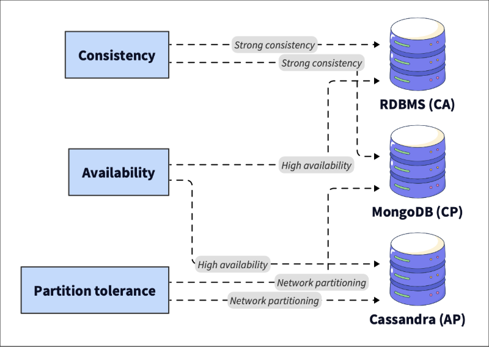

# System Design

## What is System Design?

System Design is the process of defining how indovidual software components come together to meet a set of requirements. It connects abstract business goals and concrete technical implementations. This involves making choices about architecture, data flow, scalability, fault tolerance, and trade offs among goals such as cost speed, and complexity.

System Design generally falls into two categories:

High level system design that focuses on the overall architecture, communication between services, and major technology choices.

Low level system design zooms into how individual modules, API's, or data models work internally.

A good System design balances multiple qualities:

1. Scalability to ensure the system handles growth.

2. Reliability to guarantee it works despite failures.

3. Performance that focuses on meeting latency and throughput goals.

4. Maintainability that ensures the code is easy to debug and evolve.

5. Cost-efficiency that ensures resources are used widely.

These are not independent concerns, and every choice always comes with trade-offs. A skilled system designer can navigate those trade-ffs thoughtfully. 

## Why System Design is important?

System design bridges the gap between theoretical knowledge and real-world software engineering. It is where computer science fundamentals, such as algorithms, data structures, networking and databases all come together to create reliable systems for real-world users.

Mastering system design matters for several reasons:

1. Scalability is no longer optional. Modern applications must serve millions of people globally. System design teaches you how to build to scale from database sharding to load balancing.

2. Reliability is key. A well designed system minimizes downtimes, isolates failures and recovers gracefully. This protects user trust and business continuity.

3. Engineering Maturity. Understanding system design helps you think beyond code, anticipate bottlenecks, and communicate better with architects, DevOps engineers and stakeholders.

4. Career growth. Senior engineers and tech leads are expected to think in systems. This includes designing architectures, evaluating trade-offs, and mentoring others through design decisions.

Ultimately, System Design is about thinking holistically. It involves understanding how to build a feature and how that feature fits into the system that lasts. This skill is the key differentiator for senior engineering roles.

To build these systems effectively, you need shared language of core concepts.

## Key Concepts and Terminology

These core system design concepts form the foundation for every large scale architecture. A deep understanding of them enables you to make more informed design decisions and communicate effectively with your peers.

### Scalability
Scalability means your system can handle increased loads, such as more users, more traffic without a proportional drop in performance. It describes how well a system grows under load.

Vertical scaling (scale-up) means adding more resources to a single machine. It's simpler but limited by hardware contraints.

Horozontal Scaling (scale-out) means adding more machines or instances to increase capacity. It's harder to manage but offers near-infinite growth potential.

### Reliability and Availability

These two terms often appear together but focus on slight different things. Reliability refers to the consistency with which a system performs its intended function without failure. Availability measures how often the system is operational, typically expressed as an uptime percentage.

Engineers use specific metrics to measure these qualities.

Service level indicator (SLI) is the measure metric.

Service level objective (SLO) is the target goal.

Service level agreement (SLA) is the contract with users regarding acceptable downtime.

Techniques such as redundancy, replication, and automatic failure ensure that if one component fails, users are not affected. For example, YouTube continues to operate after a data center failure due to its reliability at scale.

### Consistency and Partition Balance

The consistency, availability and partition tolerance (CAP theorem) states that in a distributed system, you can only guarantee two of the following three properties at once.

1. Consistency so that every read returns the latest successful write (or an error).
2. Availability so that ever request receives a non-error response (even if its not the latest data).
3. Partition tolerance so that the system continues operating despite network partitions (dropped/delayed messages).

Real systems, such as Cassandra or MongoDB, choose different trade-offs, depending on the use case. Understanding CAP is crucial to making informed decisions about databases and architecture. In practice, partition tolerance is mandatory in distributed systems, so the choice is usually between Consistency (CP) and Availability (AP).

### Latency vs Throughput

Performance is usually analyzed based on speed and volume.

Latency is the time it takes to process a single request.

Throughput is the number of requests a system can handle per second.

Designing how low latency often increases cost or complexity, while designing for high throughput may sacrifice respond speed. Engineers learn how to balance these in context. You should measure latency using percentiles, such as p95 or p99, rather than averages, as averages hide the experience of the slowest users.

### Load balancing, Caching, and Sharding

These are the key scalability techniques that prevent bottlenecks.