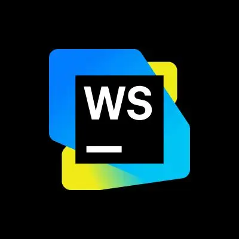

# WebStorm

## Overview
- WebStorm is a JetBrains IDE for JavaScript and TypeScript.
- It is also suited for web application development.
- It works across supported operating systems.
- It can open and manage complete project folders.
- It provides editing, debugging, testing, and deployment tools.
- Core JavaScript and TypeScript tools work out of the box.
- JetBrains AI Assistant is optional and paid.
- Database tools are included at no extra cost.
- The interface can be customized for different workflows.
- Plugins extend the IDE.

## Getting Started
- Create a new project or open an existing folder.
- Let WebStorm detect the project structure.
- Use the Project tool window to browse files.
- Use the editor to open and change files.
- Use the terminal for command-line tasks.
- Use package managers inside the IDE.
- Configure a Node.js or browser run configuration.
- Install project dependencies before running the app.
- Save changes with Ctrl+S.
- Use the status bar to inspect project information.
- Use Settings to configure the IDE.
- Use Search Everywhere to find settings and actions.

## Code Editing
- Context-aware completion suggests keywords and symbols.
- Completion considers the current type and scope.
- Completion can use symbols from different languages.
- Press Tab or Enter to accept a suggestion.
- Postfix completion transforms existing code.
- Live templates insert reusable code patterns.
- Emmet expands HTML and CSS abbreviations.
- Multiple carets allow edits in several locations.
- Duplicate code detection finds repeated code.
- Line editing actions speed up common changes.
- Smart quotes and brackets reduce typing mistakes.
- Code formatting keeps files consistent.
- Configure formatter rules in Settings.
- Use Prettier to format files or selected code.
- Prettier can run automatically on save.
- Prettier can be set as the default formatter.
- WebStorm supports HTML, CSS, and JavaScript.
- WebStorm supports TypeScript and modern frameworks.
- Browsers and Node.js are common runtimes.
- HTML-linked files can be previewed inside the IDE.
- The built-in HTML preview reloads after saves.

## Code Quality
- WebStorm includes hundreds of inspections.
- Inspections detect errors and warnings as you type.
- A spelling and grammar checker checks text.
- ESLint integration adds linting feedback.
- Stylelint integration supports stylesheet checks.
- Configure ESLint and Stylelint in project settings.
- Warnings appear directly in the editor.
- Quick fixes repair common problems.
- Press Alt+Enter to view quick fixes.
- Inspection results can be reviewed in a tool window.
- Fixing one result may resolve several related issues.
- Avoid disabling inspections unless necessary.
- Match inspection rules to team standards.
- Use code style settings for consistent formatting.
- Reformat changed files before committing.

## Documentation and Hints
- Hover over a symbol to see quick documentation.
- Place the caret on a symbol and press Ctrl+Q.
- Documentation can include descriptions and signatures.
- Parameter hints show method and function arguments.
- Parameter hints update while typing a call.
- Quick documentation avoids switching to a browser.
- Navigation links can open the related declaration.
- Use documentation to understand unfamiliar APIs.

## Safe Refactoring
- Rename symbols across the whole codebase.
- Rename files and folders safely.
- Extract variables from expressions.
- Extract methods or functions.
- Extract components when supported.
- Move classes or modules.
- Change function signatures.
- Refactoring checks for possible conflicts.
- WebStorm warns about risky changes.
- Preview refactoring results before applying them.
- Refactoring updates references consistently.
- Use version control as an extra safety net.

## Navigation
- Press Shift twice to open Search Everywhere.
- Search Everywhere finds actions and settings.
- It can find files, classes, and symbols.
- It can search text strings.
- Ctrl+B goes to a declaration.
- Ctrl+click can jump to a symbol.
- Find usages to locate symbol references.
- Use breadcrumbs to see the current file location.
- Recent files reduce repeated project browsing.
- Modified files are easy to return to.
- Tabs provide quick file navigation.
- Tabs can be disabled for shortcut-based navigation.
- The Project tool window shows project files.
- File structure views show symbols in one file.
- Back and Forward shortcuts move through navigation history.

## Search and Replace
- Use Find in Files for project-wide searches.
- Replace text across matching files.
- Narrow searches by file type.
- Narrow searches by project scope.
- Search only within a selected code fragment.
- Search for class and method names.
- Search for text strings.
- Use filters to remove unrelated files.
- Review matches before replacing them.
- Regular expressions can support advanced searches.
- Case sensitivity can be changed as needed.
- Search shortcuts speed up repeated lookups.

## Version Control
- WebStorm includes Git integration.
- Compare branches in the IDE.
- View diffs before committing.
- Resolve merge conflicts with a visual editor.
- Use the Commit tool window to review changes.
- Stage or unstage selected files.
- Create and switch branches.
- View commit history.
- Fetch, pull, and push repository changes.
- GitHub projects can be managed from WebStorm.
- Local History tracks project-file changes.
- Local History works even without Git.
- Recover deleted or modified files through Local History.
- Roll back small changes when needed.
- Commit messages can be edited before pushing.
- Review a diff before completing a merge.

## Debugging
- WebStorm can debug browser applications.
- It can debug Node.js applications.
- Set breakpoints in the editor gutter.
- Step over a function call.
- Step into a function call.
- Step out of the current function.
- Run code until the next breakpoint.
- Watch variables during execution.
- Inspect the call stack.
- Evaluate expressions in the debugger.
- Pause execution to inspect a live state.
- Debug configurations save launch settings.
- Use logs to track runtime behavior.
- Debugging works from a unified IDE interface.

## Unit Testing
- Jest is supported.
- Mocha is supported.
- Vitest is supported.
- Protractor is supported.
- Run tests from the editor or test tool window.
- Debug tests with breakpoints.
- Review test results in a tree view.
- Navigate from a failed test to its source.
- Jest can show code coverage reports.
- Vitest can show code coverage reports.
- Mocha can show code coverage reports.
- Coverage shows exercised and missed code.
- Test files can be organized in project folders.
- Use test runners appropriate to the framework.

## Docker and Containers
- WebStorm integrates with Docker.
- Download Docker images.
- Build Docker images.
- Run applications in containers.
- Debug applications in containers.
- Use Docker Compose for multi-container apps.
- Manage container configuration from the IDE.
- Inspect container-related output.
- Configure Docker only when the project needs it.

## Terminal
- WebStorm includes a built-in terminal.
- The terminal uses the operating system shell.
- Run npm, Yarn, or pnpm commands.
- Navigate to project files from the terminal.
- Open multiple terminal tabs.
- Keep build and server commands visible.
- Close terminals that are no longer needed.
- Use the terminal as a local command-line workspace.

## HTTP Client
- The built-in HTTP Client sends web requests.
- Create requests in editor files.
- Edit request methods and URLs.
- Add request headers.
- Send request bodies.
- Run requests to test APIs.
- Review responses inside the IDE.
- Share HTTP request files with a team.
- Store environment variables for repeated requests.

## Package Managers
- WebStorm integrates with npm.
- WebStorm integrates with Yarn.
- WebStorm integrates with pnpm.
- Install packages from inside the IDE.
- Locate packages used by the project.
- Update packages when dependencies change.
- Remove unused packages.
- Review package scripts.
- Run package-manager commands from package manifests.
- Keep the lockfile under version control.

## Database Tools
- Database tools are bundled with WebStorm.
- SQL support is included at no extra cost.
- Connect to supported databases.
- Create database objects.
- Manage database objects.
- Run SQL queries.
- Review query results.
- Browse database schemas.
- Keep database credentials secure.
- Install the database plugin only if project setup requires it.

## JetBrains AI Assistant
- AI Assistant is a paid feature.
- Chat with AI about the project.
- Keep conversations inside the IDE.
- Ask about a selected code fragment.
- Generate test code.
- Generate documentation for declarations.
- Explain code changes.
- Summarize Git diffs.
- Explain the purpose of a diff.
- Generate commit messages.
- Use custom project-aware prompts.
- AI actions consider project technologies.
- AI actions can consider local changes.
- AI actions can consider recent commits.
- Review AI output before applying it.
- Do not share secrets in AI prompts.

## Remote Development
- Remote development supports lightweight local clients.
- The local client stays responsive.
- Heavy processing can run on a remote server.
- Open projects stored on remote machines.
- Debug remotely without leaving the IDE workflow.
- Use remote development when local hardware is limited.
- Requires remote development configuration.
- Network reliability affects the experience.

## Customization
- Choose from predefined UI themes.
- Use custom themes and appearance settings.
- Change UI element visibility.
- Move tool windows as needed.
- Resize tool windows.
- Switch to Zen mode for focused coding.
- Customize text size.
- Customize editor colors.
- Personalize keyboard shortcuts.
- Use predefined keymaps.
- Use a VS Code keymap.
- Use a Sublime Text keymap.
- Create a custom keymap.
- Shortcuts exist for nearly every action.
- Plugins add features and integrations.
- Browse plugins in JetBrains Marketplace.
- Install plugins only when needed.
- IdeaVim adds Vim-style modes.
- IdeaVim supports motion and marks.
- Configure IdeaVim for normal, insert, and visual modes.
- WebStorm includes accessibility settings.
- Screen reader support is available.
- Settings Sync shares JetBrains IDE settings.
- Sync UI settings when desired.
- Sync code and system settings.
- Sync keymaps and plugins.
- Sync tools and preferences.
- Choose exactly which settings are synchronized.

## Quick Workflows
- Open a project and let it index.
- Configure dependencies and run tools.
- Use completion and live templates while coding.
- Run inspections regularly.
- Format changed files.
- Refactor with preview and warnings.
- Use navigation instead of manual browsing.
- Create focused commits.
- Review diffs before committing.
- Debug from the same project window.
- Run and review tests.
- Use Docker only for containerized applications.
- Use the terminal for package-manager commands.
- Use the HTTP Client for API checks.
- Use database tools for SQL work.
- Use AI assistance for review and generation.
- Sync settings across JetBrains IDEs.

